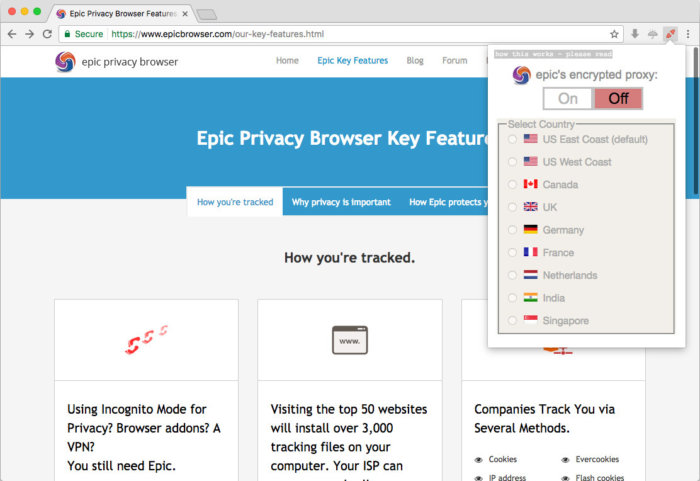
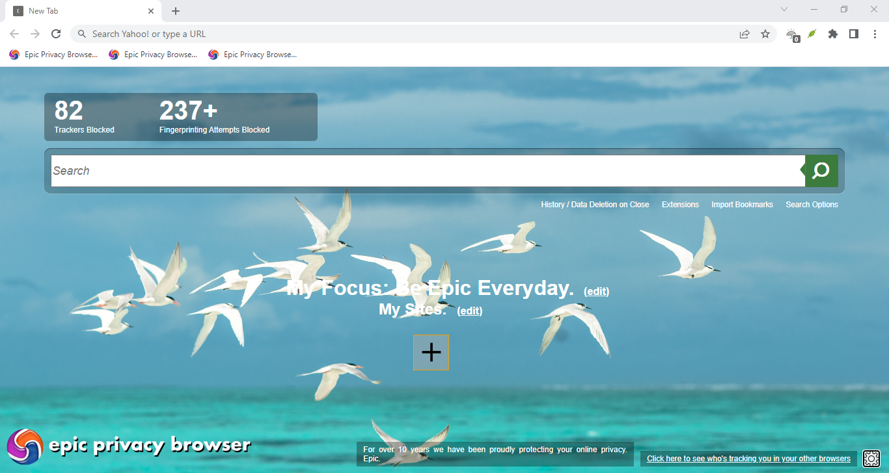

# Epic Privacy Browser for Private Everyday Browsing

[](https://github.com/epic-browser/epic-browser/releases/)

Epic Privacy Browser is Hidden Reflex's browser for reducing everyday web tracking.
Its desktop experience combines Chromium compatibility with built-in privacy controls.
Windows, macOS, Android and iOS editions are available.

## Objectives

1. Reduce tracking requests before they become part of a browsing session.
2. Keep familiar navigation, tabs and everyday website workflows.
3. Let users choose how much session information remains after closing Epic.

These objectives cover different parts of privacy.
Blocking a request, clearing local data and changing an IP address serve different purposes.

## Content Overview

- [Feature Overview](#feature-overview)
- [Session Privacy](#session-privacy)
- [Search and Site Exceptions](#search-and-site-exceptions)
- [Extensions and Compatibility](#extensions-and-compatibility)
- [Encrypted Proxy Status](#encrypted-proxy-status)
- [Available Platforms](#available-platforms)
- [Build Identification](#build-identification)
- [Package Inspection](#package-inspection)
- [Source Code and Contributions](#source-code-and-contributions)
- [Practical Review Checklist](#practical-review-checklist)

## Feature Overview

Epic combines several controls rather than relying on a single browsing mode.
The following distinctions help explain what each control addresses.

| Control | Purpose | Useful distinction |
| --- | --- | --- |
| Ad and tracker blocking | Reduce advertising and tracking requests | Site exceptions can change behavior |
| Fingerprinting defenses | Limit selected identifying browser signals | Coverage is not universal |
| Third-party cookie blocking | Restrict cross-site cookie use | First-party storage has a separate role |
| Local address suggestions | Complete addresses from a local database | Submitting a search still contacts a service |
| Optional private mode | Remove session data when Epic closes | The setting must be enabled |
| WebRTC leak blocking | Block calls that can expose an IP address | This does not create a VPN connection |



### Reading the controls

Use the umbrella controls to inspect available privacy settings.
Review a page's behavior before making an exception.
A working sign-in form and a blocked advertising widget have different requirements.

## Session Privacy

Desktop Epic supports regular browsing and an optional always-on private mode.
Choose the mode according to whether session continuity or cleanup matters more.

### Persistent sessions

A retained session can be convenient for work that continues across browser launches.
Check the selected mode before relying on that continuity.
Downloaded documents should be managed separately from browsing history.

### Private sessions

With always-on private mode enabled, closing Epic clears specified browser data.
This includes cookies, history and local website storage.
Expect some websites to request another sign-in in a later session.

Deleting browser data is different from securely erasing a storage device.
Operating-system caches and other applications have their own data lifecycles.

## Search and Site Exceptions

Search privacy depends on the service receiving the query as well as the browser.
Local autocomplete reduces background address-bar transmission.
Sending a completed search still passes that query to the chosen provider.

### Advertising exceptions

Epic's published policy lists Yahoo properties as exceptions to its ad blocker.
It also describes a brief blocking suspension after a Yahoo Search advertisement click.
Account for this exception when comparing blocking behavior between pages.

### Recognized accounts

Signing in tells that service which account is using the page.
A private window does not make an authenticated account anonymous.
Consider the account context when moving between personal and research tasks.

## Extensions and Compatibility

Desktop Epic supports Chrome Web Store extensions.
An extension's permissions determine which browser activity it can access.
Review those permissions alongside the function the extension provides.

### A small extension set

- Retain extensions that have a clear role in your workflow.
- Check whether an extension duplicates an existing browser control.
- Revisit permissions when an extension changes ownership or behavior.
- Retest affected pages after changing the extension set.

### Media playback

Desktop Epic includes Widevine for services that require protected video playback.
The component can contact its servers for updates.
This is a documented exception to an assumption of zero Google-related connections.

## Encrypted Proxy Status

The phrase "epic encrypted proxy" often appears in older descriptions of Epic.
Those descriptions should not be treated as a current service guarantee.

Epic's current desktop website points users toward third-party proxy or VPN extensions.
The Android release listing explicitly states that its VPN service was discontinued.
Check the actual edition and provider before relying on network routing.

A browser extension and a system-wide VPN can cover different traffic.
Changing one does not establish the routing behavior of every application.

## Available Platforms

The publisher separates desktop packages from mobile store releases.
Desktop version labels should not be applied automatically to mobile editions.

| Edition | Published distribution | Detail to check |
| --- | --- | --- |
| Windows | Executable and ZIP packages | Installed build and package signature |
| macOS, Apple silicon | Processor-specific disk image and ZIP | Apple silicon package selection |
| macOS, Intel | Separate disk image and ZIP | Intel package selection |
| Android | Google Play | Mobile features and current release notes |
| iPhone and iPad | App Store | Store compatibility for the device |

A Linux package is not listed on the current official download page.
Minimum operating-system versions should be checked for the exact package or store listing.



### Android feature differences

The Android listing describes a File Vault, Audio Queue and reader mode.
Its ad blocker is provided through Epic's extension store.
Do not assume desktop extension support describes the Android extension system.

## Build Identification

The official download page exposes a version label through its website script.
That label and package directory names currently differ.
Read the installed executable's metadata when documenting a Windows build.

This Windows PowerShell example reads metadata from a file you select.
It does not launch Epic or change its settings.

```powershell
$epicExecutable = Read-Host 'Full path to the installed Epic executable'
$epicFile = Get-Item -LiteralPath $epicExecutable
$epicFile.VersionInfo | Select-Object ProductName, ProductVersion, FileVersion
```

Keep the full version string when reporting a problem.
Record the operating system and processor architecture separately.

## Package Inspection

Windows PowerShell can also report a package's Authenticode signature.
Select the actual executable package rather than its enclosing ZIP archive.

```powershell
$epicPackage = Read-Host 'Full path to the Epic executable package'
$epicSignature = Get-AuthenticodeSignature -LiteralPath $epicPackage
$epicSignature | Select-Object Status, StatusMessage, SignerCertificate
```

Compare the reported signer with the publisher information for that package.
An absent signature does not establish who produced a file.

## Source Code and Contributions

Epic's FAQ describes its code as available for inspection on request.
It does not provide a public Epic source repository or a reproducible build guide.
A Chromium build command alone is therefore insufficient to reproduce Epic.

For a useful technical report, include the edition, complete version and affected page.
Describe the privacy settings and extensions involved.
Remove credentials and personal browsing information from any shared diagnostic material.

## Practical Review Checklist

- Confirm whether the current session is persistent or private.
- Check exceptions before judging a page's blocking results.
- Distinguish browser privacy controls from network routing.
- Match support information to the desktop or mobile edition.
- Record the complete installed version before comparing releases.

## Related Search Terms

epic privacy browser, epic browser, epic privacy, epic privacy browser android, epic encrypted proxy, browser, chromium, privacy, control, transparency, web, web-browser, windows, macos, android
